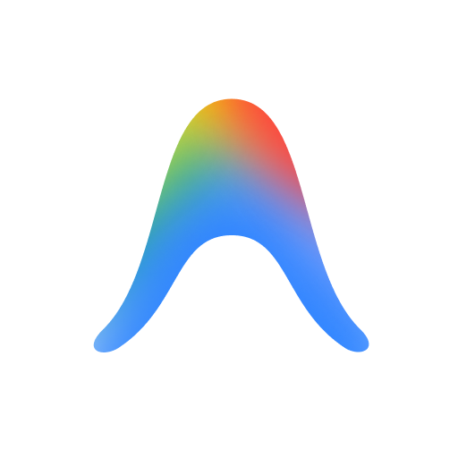
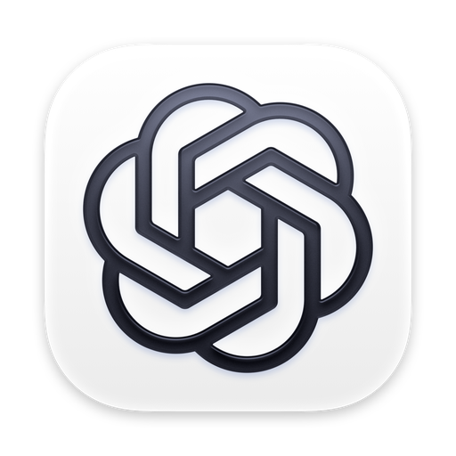

<p align="center">
  
</p>

<h1 align="center">AIUsage</h1>

<p align="center">
  <b>A sleek, native macOS menu bar app for instant, real-time access to your AI Model Quotas and account usage.</b>
  <br />
  Built in Swift &amp; SwiftUI &bull; macOS 27 Liquid Glass UI &bull; Zero Prompt Token Overhead
</p>

<p align="center">
  <a href="https://github.com/desmondlee95700/AIUsage/releases/latest"></a>
  
  
  
  <a href="LICENSE"></a>
</p>

---

## ⬇️ Download & Installation

### Option 1: Direct Download (Recommended)
Download the latest pre-compiled macOS disk image:

👉 **[Download AIUsage.dmg](https://github.com/desmondlee95700/AIUsage/releases/latest/download/AIUsage.dmg)**

1. Open `AIUsage.dmg`.
2. Drag **AIUsage.app** into your `/Applications` folder.
3. Launch **AIUsage** — it will immediately appear in your macOS menu bar!

> [!TIP]
> **macOS Gatekeeper Notice ("Apple could not verify "AIUsage.dmg" is free of malware")**:  
> Because AIUsage is an independent open-source app distributed outside the Mac App Store without an Apple Developer ID certificate, macOS attaches a quarantine flag to files downloaded via browsers (Chrome, Safari) and blocks them.
> 
> If the DMG won't open, click **Done** (not *Move to Trash*), then open **Terminal** and clear the flag before opening it again:
> ```bash
> xattr -d com.apple.quarantine ~/Downloads/AIUsage.dmg
> ```
> Downloaded a different file, such as `AIUsage-v2.6.1.dmg` from the Releases page? Use its name instead:
> ```bash
> xattr -d com.apple.quarantine ~/Downloads/<file name>.dmg
> ```
> If the app itself is later reported as **"AIUsage is damaged and can't be opened"**, run:
> ```bash
> xattr -cr /Applications/AIUsage.app
> ```
> *(Or navigate to **System Settings > Privacy & Security**, scroll down to **Security**, and click **Open Anyway**.)*

### Option 2: Homebrew
```bash
brew install --cask desmondlee95700/tap/aiusage
```
The full name adds and trusts [the tap](https://github.com/desmondlee95700/homebrew-tap) for you.
The cask tracks the latest stable release. AIUsage updates itself, or run `brew upgrade --cask aiusage`. The Gatekeeper notice above applies on first launch too.

---

## ✨ Features

### 🤖 Multi-Provider Capabilities Matrix

| Provider | Tracked Metrics | Connection Protocol | Token Overhead | Auto-Discovery |
| :--- | :--- | :--- | :---: | :---: |
|  **Google Antigravity** | • Rolling 5-Hour Limit<br>• Weekly Quota Limit<br>• Prompt & Flow Credits<br>• Google Account Tier & Email | Local Connect-RPC (`127.0.0.1`) | **0 Tokens** | ✅ Instant |
|  **OpenAI ChatGPT** | • 5-Hour Burst Limit<br>• Weekly Quota Limit<br>• Reset Credit Redemption<br>• OpenAI Plan & Email | Local Codex JSON-RPC stdio | **0 Tokens** | ✅ Instant |
|  **Anthropic Claude** | • 5-Hour Rolling Limit<br>• Weekly Quota Limit<br>• Sonnet & Opus Weekly Limits (when your plan has them)<br>• Extra Usage Credits<br>• Claude Plan & Email | Desktop session / Claude Code sign-in | **0 Tokens** | ✅ Instant |

<br />

### 🍎 App & macOS Experience

| Feature | Description |
| :--- | :--- |
| 🎛️ **Flexible Provider Focus** | Toggle any combination of active models (Antigravity, ChatGPT, Claude) with persistent in-menu checkboxes and an in-popover filter slider. |
| 📊 **Menu Bar Telemetry** | Shows each provider's **lowest** remaining limit side by side (e.g. `78% · 90% · 4%`), so a full 5-hour window can't hide an exhausted weekly one. Two thin bars beside each figure show the 5-hour (top) and weekly (bottom) limits, with the one behind the figure drawn solid. A ⚠︎ marks anything at 10% or below, providers that are off are dimmed, and the hover tooltip breaks down every window. Prefer a quieter bar? Switch to **Icon Only**. |
| 🔔 **Low-Quota Alerts** | Notifies you when a 5-hour or weekly limit drops past 30% and 10%, including when it resets. Alerts only fire on active use, never for quota that was already low at launch. Choose 30% and 10%, 10% only, or off. The first time you open the popover, a card offers to turn alerts on, so the macOS permission prompt only appears when you ask for it. If notifications are later blocked, the popover says so and links straight to the setting. |
| 📈 **Token Activity** | 7, 14 or 30-day charts of Claude Code and Codex token use, read from local session logs (desktop app and CLI). |
| 🪟 **macOS 27 Liquid Glass** | Native `.ultraThinMaterial` substrate, specular rim refraction gradients and viscous spring mechanics. The popover keeps a fixed height (shrinking on small screens), so switching providers never resizes it; when a page runs longer, the bottom edge fades and a chevron scrolls you to the rest. |
| 🔒 **Private by Design** | Zero telemetry, zero LLM prompts consumed, and no credentials saved. Antigravity and ChatGPT are read locally; Claude usage is fetched from Anthropic's own usage endpoints using your existing sign-in. |
| 🔄 **Auto-Discovery & Recovery** | Automatically detects running desktop instances and seamlessly reconnects whenever any AI application is launched or restarted. |

---

## 🛠️ Building from Source

```bash
# Clone the repository
git clone https://github.com/desmondlee95700/AIUsage.git
cd AIUsage

# Build and package the .app bundle
./scripts/build_app.sh

# Or create a distributable compressed DMG
./scripts/build_dmg.sh

# Launch the app
open AIUsage.app
```

---

## ⚙️ Controls & Shortcuts

### 🖱️ Mouse & Menu Bar Gestures

| Gesture | Target | Action |
| :--- | :--- | :--- |
| **Left-Click** | Menu Bar Item | Opens or dismisses the Liquid Glass quota inspector popover. |
| **Right-Click** / **Control-Click** | Menu Bar Item | Opens the full macOS context menu with quick settings and actions. |
| **Hover** | Menu Bar Item | Displays a multi-model tool tip with every limit, its reset time, and what to do when a provider is offline. |
| **Option (⌥) + Click** | Provider Item | Solo Mode: Instantly selects only that provider in the focus menu. |

<br />

### 🎛️ Popover Header Controls

| Control | Icon | Action |
| :--- | :---: | :--- |
| **Provider Filter** | `slider.horizontal.3` | Opens multi-select popover to toggle active providers without closing the menu. |
| **Provider Switcher** | Segment Tabs | Toggles provider dashboards (Antigravity, ChatGPT, Claude) with zero height shift. Each tab shows the menu bar figure, marked "weekly" when it comes from the weekly limit. |
| **Freshness** | Status Pill | How old the numbers on screen are; turns amber when they've missed several refreshes. |
| **Refresh Quotas** | `arrow.clockwise` (🔄) | Runs spring-animated icon spin and forces local service re-discovery and quota poll. |
| **Update Available** | `arrow.down` (⬇️) | Dynamic badge that appears when a new GitHub release is detected; 1-click prompts download. |
| **More** | `ellipsis` (⋯) | Grouped settings: refresh interval and low-quota alerts; menu bar style and Hide Email Addresses; Launch at Login and Open App; then Check for Updates and Quit. The app version sits under the AIUsage name in the header. |

A small menu bar glyph (`menubar.rectangle`) beside a limit marks the figure your menu bar is showing.

<br />

### ⌨️ Context Menu & Keyboard Shortcuts

| Shortcut | Command | Action |
| :---: | :--- | :--- |
| <kbd>⌘</kbd> <kbd>R</kbd> | **Refresh All Now** | Forces immediate re-probe and quota fetch across all active providers. |
| <kbd>⌘</kbd> <kbd>U</kbd> | **Check for Updates...** | Checks GitHub Releases for new DMG builds and prompts direct download. |
| <kbd>⌘</kbd> <kbd>Q</kbd> | **Quit AIUsage** | Terminates the application. |
| — | **Provider Focus** | Persistent multi-choice submenu with individual provider checkmarks. |
| — | **Refresh Interval** | Configure automatic polling cadence (30s, 1m, 2m, 5m, or Manual). |
| — | **Menu Bar** | Show Percentages, or Icon Only. |
| — | **Low-Quota Alerts** | At 30% and 10% (default), at 10% only, or off, plus whether notifications are allowed and a one-click fix if not. |
| — | **Launch at Login** | Starts AIUsage automatically when you log in (macOS Login Items). |
| — | **Hide Email Addresses** | Masks account emails in the popover, for screenshots and screen sharing. |

---

## 📄 License

This project is licensed under the **[MIT License](LICENSE)** &mdash; see the [`LICENSE`](LICENSE) file for complete details.

Copyright &copy; 2026 [Desmond Lee](https://github.com/desmondlee95700). Free and open-source software for personal and commercial use.
